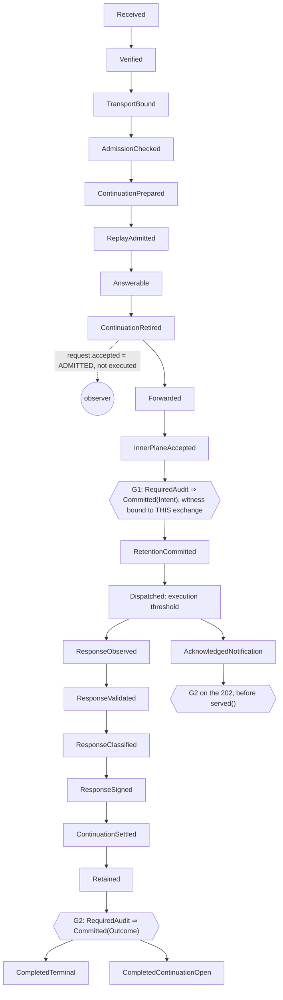
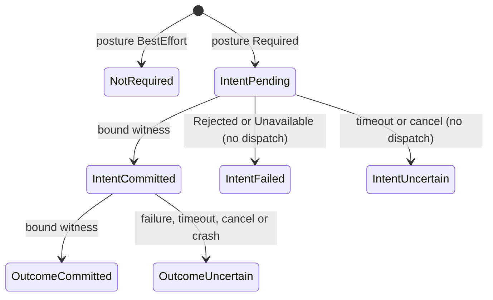

<!-- SPDX-License-Identifier: Apache-2.0 -->

# ADR-MCPRE-070 — Audit commitment: observation is not commitment

**Status:** **PROPOSED** 2026-10-19, with all twelve decisions ruled by the owner on 2026-10-19
(§15). The rulings bind the implementation slices of epic #1201. The document itself is under
review for ratification in its Discussion, and that review does not suspend the slices.
**Discussion:** [#1212](https://github.com/matssun/mcp-re/discussions/1212).
**Issue:** #1191 (Slice 0). **Epic:** #1201.
**Constrains / relates:** ADR-MCPS-035 (audit vocabulary), ADR-MCPRE-066
([`audit-composition.md`](audit-composition.md)), THM-0071 (and THM-0070, THM-0085).

This ADR defines **semantics only**. It implements no transport and changes no persistence
claim. The two vocabulary changes it authorizes (the `execution.intent` category, D1, and one
`McpReError` variant, D12) land in the implementation slices, not in this document. Every `path:line` reference is
pinned at `8262c5fa` and every fact is MEASURED from source unless marked INFERRED. Type and
state names written in *italics* are illustrative, not decided.

## 1. Context

| # | fact | ref | kind |
|---|---|---|---|
| F1 | The audit sink returns nothing: `fn record(&self, record: &AuditRecord)`. Its contract is that it MUST NOT fail the request. | `mcp-re-proxy/src/audit_sink/mod.rs:29-41` | measured |
| F2 | The single funnel `record_to` is a no-op without a sink, and it wraps `sink.record` in `catch_unwind` and discards the result. | `mcp-re-proxy/src/audit_record/mod.rs:151-173` | measured |
| F3 | Stderr delivery is a bounded `sync_channel(4096)`. `offer` never blocks: if the queue is past the ceiling or `try_send` fails, the record is dropped and counted. Unattributed records may fill only 3072 slots. | `mcp-re-proxy/src/audit_sink/mod.rs:58-123` | measured |
| F4 | `seq` is allocated by `fetch_add` inside the sink, before the hand-off, so a drop leaves a hole. Rendering saturates at `i64::MAX`. | `mcp-re-proxy/src/audit_sink/stream.rs:86-93`, `audit_sink/stderr.rs:81-108` | measured |
| F5 | Seq allocation and enqueue are two steps, so stderr lines can reach the stream out of seq order across cores. | `audit_sink/stderr.rs:82-90` | INFERRED |
| F6 | The shutdown drain is bounded at 2 s and reports `Drained` or `OutcomeUnknown`. Records offered during the flush fall outside the claim. | `mcp-re-proxy/src/audit_sink/drain.rs:26`, `:148-170` | measured |
| F7 | `request.accepted` is emitted at `ContinuationRetired`. It means ADMITTED, and it comes before forward, prepare, signing window, retention reserve and retention commit, each of which can still refuse. | `receipt/audit_event.rs:37-70`, `http_profile_serve/mod.rs:471`, `http_profile_serve/dispatch_commitment.rs:115-140` | measured |
| F8 | The irreversible dispatch (`advance(BackendDispatched)`, then `dispatch().await`) emits **no audit event**. | `http_profile_serve/mod.rs:490-496` | measured |
| F9 | `ReadyForDispatch::new(prepared, window, retention)` carries no audit input. `Accepted` precedes dispatch only through the call graph. | `mcp-re-proxy/src/request_stages.rs:117-155`, `dispatch_commitment.rs:107-114` | measured |
| F10 | `response.signed` is emitted after retention completes and before `publish(success)` and `served()`. | `reply_assembly/accepted.rs:67-90` | measured |
| F11 | The notification arm enters `AcknowledgedNotification` before the 202 is signed, retained and recorded, and records `response.signed` with status 202, the same token as a bodied reply. | `reply_assembly/notification.rs:66-76`, `:127` | measured |
| F12 | `response.rejected` covers both pre-dispatch refusals (NothingExecuted) and post-dispatch refusals (PossiblyExecuted). The record has no execution coordinate; the disposition travels only in the signed rejection body. | `dispatch_commitment.rs:47-57`, `reply_assembly/accepted.rs:132-153`, `receipt/audit_event.rs:134-141` | measured |
| F13 | No record carries an exchange identity, so `accepted` and `signed` correlate only by actor and time. Nonce and correlation state are omitted on purpose (ADR-MCPS-020). | `audit_sink/mod.rs:9-15` | measured |
| F14 | Cancellation, future drop, and panic on the serving path emit nothing. | `async_serve/connection.rs:131-139` | measured (panic path INFERRED) |
| F15 | A durable commit-before-dispatch already exists for retention (ADR-MCPRE-054): a `.pending` marker with no `Drop`, fsync before acknowledgement, at most 1024 reservations, and overload refused before dispatch. It is opt-in. | `transparency/dispatch_committed.rs:16-35`, `transparency/durability_bounds.rs:17`, `transparency/durability.rs:56-60` | measured |
| F16 | `backend_may_have_executed()` is already true AT `RetentionCommitted`, where no byte has yet left the process. | `mcp-re-proxy/src/exchange_state.rs:385-416` | measured |
| F17 | The success allowlist is closed at two: "no third success event may be minted without an ADR". A rejection `reason` is exactly `McpReError::wire_code()`. | `mcp-re-core/src/audit.rs:69-73`, `:94-100` | measured |
| F18 | Disclaimer: "Durable audit persistence. THM-0071 is about the modeled in-process path." | `docs/spec/security-boundary.md:113-114` | measured |
| F19 | ADR-MCPS-035's prose §9 is **absent** from `docs/spec/security-boundary.md`. It survives only in a superseded archive snapshot. | §15 D6 | measured |

The drivers that follow from these facts:

- Nothing on the request path is evidence that a record persists (F1–F4, F6).
- The execution threshold has no audit fact (F8).
- `request.accepted` cannot serve as execution intent without changing what it means (F7).

## 2. Two delivery postures

| | **Best-effort observation** | **Required durable commitment** |
|---|---|---|
| what it is | today's stderr sink (or `none`), unchanged | a separately established *commitment authority* that returns a bound witness or a typed failure |
| affects the request? | never (F1) | yes: it is a prerequisite of dispatch (G1) and of visible success (G2) |
| persistence claim | none (F18) | conditional on the provider's declared tier (§9) |
| on failure | drop, count, and keep serving (F3) | fail closed before dispatch; after dispatch, never claim success and never claim NothingExecuted |
| can it mint authority? | no, by type | yes, but only through a witness the shared code binds |
| selected by | the default | explicit typed policy (#1206). Never inferred, never a silent fallback |

**Safety properties.** These are about what the proxy does with witnesses, and they hold
whatever the provider does:

- **S1** `RequiredAudit && Dispatch ⇒ Committed(Intent)`.
- **S2** `RequiredAudit && SuccessVisible ⇒ Committed(Outcome)`.
- **S3** An event ID is never bound to two digests.
- **S4** A required posture never runs as best-effort.
- **S5** At or after the threshold, nothing reports NothingExecuted (the existing rule, F16).

**Conditional liveness.** These hold only under assumptions:

- **L1** A required exchange makes progress *if* the provider answers within its bound.
- **L2** A committed event survives the loss of the proxy process *if* the provider is honest and its declared fault model holds.
- **L3** A committed event is eventually archived *if* the downstream transport, the archive and the recovery assumptions hold.

**External storage fault model.** The provider declares it. The shared code relies on it and
never assumes it beyond the declaration:

| fault | required-posture effect |
|---|---|
| proxy crash-stop (SIGKILL, OOM) | committed events must survive. This is the minimum for any qualified tier (D3) |
| provider node crash or failover | tier-dependent; replicated-in-memory tiers may lose acknowledged writes |
| partition or timeout | `Unavailable` or `Uncertain` (§3). S1–S5 hold; L1 does not |
| storage full or quota | `Unavailable`, so fail closed |
| Byzantine or lying provider | out of model. It defeats L2 and L3 and cannot be detected by shared code (§9) |

There is **no absolute, failure-independent claim**. In particular there is no claim of
exactly-once delivery and none of unconditional permanence.

## 3. Lifecycle of an audit fact

```text
Created ──► Offered (observer) ─────────────────────────────► (gone, or a line on stderr)
   │
   └────► Committing ──► Committed ──► InFlight ──► Delivered ──► Archived
               │
               ├──► Rejected     provider refused: definitely not committed
               ├──► Unavailable  provider unreachable or out of capacity: definitely not committed
               └──► Uncertain    timeout, cancel or crash after the send: may or may not be committed
```

- **Created** means the identity is allocated and the canonical bytes are fixed (§8).
- Under required posture, `Uncertain` counts as **not committed** for the prerequisite, so
  nothing is dispatched. It counts as **possibly committed** for identity, so the ID is never
  reused for other content and a retry resends the identical bytes.

| layer | what its acknowledgement means | commitment? |
|---|---|---|
| volatile queue admission: `record()`, `try_send`, a `Flush` ack | the bytes are in this process's memory, or were written to a pipe | **no** |
| network receipt: TCP ack, a collector's HTTP 2xx, an `XADD` reply | a remote process holds the bytes, possibly only in memory | **no** |
| replicated acceptance: Redis `WAIT n t` | n replicas acknowledged receipt; that says nothing about fsync | **no** |
| stable journal commitment | the event survives the declared fault model (§2) | **yes**, only as a bound witness at a declared tier |
| archive receipt | the archive has taken custody | no; this is a liveness milestone past commitment |

**An acknowledgement at one layer never implies the next.** Neither `record()`, `try_send`,
`XADD`, Redis `WAIT`, nor a provider's bare `Ok(())` is commitment.

## 4. State and authority transition model

The existing request machine R is linear (`mcp-re-proxy/src/exchange_state.rs:450-503`). This
ADR adds **two prerequisite crossings**. It does not add a branch.



The audit-commitment progress of one exchange is a **sibling machine** *A* (D7).
Today's tuple already has the siblings R, C, B, O and L (`mcp-re-proxy/src/exchange_state.rs:569-582`).
Making it a sibling leaves the frozen request region (`:471`) untouched (D7).



| crossing | placement | type-level form (illustrative) |
|---|---|---|
| **G1** intent | After every refusable step whose failure leaves no durable trace (forward, prepare, signing window, retention reserve). Before the retention commit and before `BackendDispatched`. The ordering against `RetentionCommitted` is D7. | `ReadyForDispatch::new` takes an *IntentDisposition* = `NotRequired` \| `Committed(witness)`, on the pattern of `RetentionDisposition` (`mcp-re-proxy/src/request_stages.rs:95-105`). `NotRequired` is not a fake witness. |
| **G2** outcome | Bodied path: after `Retained`, before `progress.publish(success)` and `served()` (`reply_assembly/accepted.rs:82-90`). Notification: before `served(ack)` (`reply_assembly/notification.rs:76`), because its terminal state is already entered at `:127` (F11). | The success-serve step takes an *OutcomeDisposition* bound to the same exchange coordinate. |

- **Execution intent is a fact distinct from `request.accepted`.** Admitted ≠ executed. Five
  refusal points lie between the two (F7).
- **Decision ownership.** The state machine and the semantic owners decide what happened. The
  commitment authority records a fact it was handed. A transport never reinterprets a
  verification, authorization, replay or signing decision. It can only refuse to commit, and
  that refusal is a commitment failure, never a verdict about the request.

## 5. Coverage matrix

Fact-base row numbers come from #1191's investigation. "Required" columns follow the owner
rulings in §15.

| path | today's event (ref) | best-effort posture | required: committed? | required: outcome |
|---|---|---|---|---|
| TLS or client-cert refusal | none (`async_serve/connection.rs:52-53`) | unchanged | no (D2) | as today |
| per-core shed 503, malformed header 400, oversized or late body 413, body budget 503, routing 403 | none (`async_serve/request.rs:66-107`, `async_serve/inbound.rs:61-129`) | unchanged | no; THM-0081 pre-exchange replies (D2) | as today |
| unauthenticated signature failure | `request.rejected`, `actor=None` (`pre_admission/mod.rs:69-91`) | unchanged, under the 3072 ceiling | not individually (D2) | refusal as today |
| envelope, binding, admission or authz refusal | `request.rejected` (`pre_admission/mod.rs:115-135`) | unchanged | attempted, not a prerequisite (D8) | refusal as today |
| continuation, replay or answerable refusal | `request.rejected` (`answering_commitment.rs:106-151`) | unchanged | attempted (D8) | refusal as today |
| `request.accepted` | admitted (`http_profile_serve/mod.rs:471`) | unchanged | attempted (D8); **not** the intent | — |
| post-accept pre-intent refusal (forward, prepare, window, reserve) | `response.rejected` (`dispatch_commitment.rs:115-135`) | unchanged | attempted (D8) | NothingExecuted |
| **intent** (new) | none | **no line**; stderr stays v0.18.1-compatible (D1) | **G1 prerequisite** | failure → typed 503 before dispatch (D12) |
| retention-commit refusal after intent | `response.rejected` (`dispatch_commitment.rs:136-139`) | unchanged | outcome attempted (D7) | NothingExecuted to the caller; audit reads intent-only as PossiblyExecuted unless the outcome commits |
| dispatch threshold | none (`http_profile_serve/mod.rs:495`) | none | covered by the intent | — |
| post-dispatch refusal: illegal upstream, sign failure, continuation record, invariant, retention-indeterminate | `response.rejected` (`reply_assembly/mod.rs:84-138`, `reply_assembly/accepted.rs:57-192`) | unchanged | outcome attempted; the refusal is served regardless (D8) | PossiblyExecuted |
| `response.signed`, bodied | after retention (`reply_assembly/accepted.rs:82-88`) | unchanged | **G2 prerequisite** | commit failure → refusal, PossiblyExecuted, never success |
| notification 202 | `response.signed`, status 202 (`reply_assembly/notification.rs:66-76`) | unchanged | **G2 prerequisite** (D4) | as bodied, with outcome kind *acknowledged* |
| 202 signing failure | `response.rejected` (`reply_assembly/notification.rs:79-89`) | unchanged | outcome attempted | PossiblyExecuted |
| cancellation or future drop | none (`async_serve/connection.rs:131-139`) | none | before G1: nothing exists; after G1: intent without outcome | `OutcomeUncertain`, read as PossiblyExecuted |
| panic on the serving path | none | none | as cancellation | as cancellation |
| shutdown or drain | stream line only (`audit_sink/drain.rs:148-170`) | unchanged | no new dispatch without a witness; outstanding commits are bounded (#1206) | dispatched exchanges fall into W4 (§6) |
| process crash | none; the queue is lost (F18) | lost | committed events survive per the provider assumption (L2) | intent-only = PossiblyExecuted |
| delegated-key lifecycle | bare `eprintln!`, outside the sink (`signing_plane/mint_successor.rs:90-98`) | unchanged | **not covered** (D11) | — |
| `--audit-sink none` | nothing (`audit_record/mod.rs:158`) | unchanged | incompatible with required: startup refuses (#1206) | — |

## 6. Crash and failure windows

| window | durable afterwards | the caller sees | audit can honestly claim | reconciliation handle |
|---|---|---|---|---|
| W1 before intent commit | nothing; a retention reservation is rescinded on drop | refusal NothingExecuted, or a reset | **NothingExecuted**: with no intent there was no dispatch (S1) | none needed |
| W2 intent commit in flight | unknown (`Uncertain`) | timeout → typed 503, NothingExecuted (nothing was dispatched); crash → reset | the proxy knows nothing ran. The store may hold an intent with no outcome, which a reconciler reads as **PossiblyExecuted** (an upper bound) | event ID + exchange coordinate; an identical retry is idempotent |
| W3 after intent, before dispatch | intent, and possibly `.pending` | refusal NothingExecuted (retention commit failed), or a reset | the live process: NothingExecuted. After a crash: **PossiblyExecuted**. Where retention is configured, a missing `.pending` corroborates no dispatch (INFERRED from the G1-before-retention ordering) | exchange coordinate, `.pending` |
| W4 after dispatch, before outcome | intent, and `.pending` where configured | a post-dispatch refusal (PossiblyExecuted), a timeout, or a reset | **PossiblyExecuted** | intent + `.pending` |
| W5 outcome commit failed | intent | refusal PossiblyExecuted, **never** the success bytes | **PossiblyExecuted**: the proxy observed an outcome it could not commit | intent; the observed outcome is in the observer line and in retention, if present |
| W6 after outcome commit, before the response write | intent + outcome | possibly nothing (the connection dropped) | the outcome was produced and committed. Delivery to the client is **not** claimed | outcome event; retention |
| W7 drain timeout | whatever was committed | in-flight exchanges are cut | nothing beyond the held witnesses; the observer drain says `OutcomeUnknown` (F6) | per-exchange as W2–W6 |

## 7. Finite-capacity policy

1. **Bounded ingress is already in place, before any record exists:** the per-core in-flight
   semaphore (`async_serve/request.rs:55-73`), the body budget and request deadline
   (`async_serve/inbound.rs:126-128`), and the handshake bound (`async_serve/connection.rs:156-171`).
   This ADR adds nothing ahead of them.
2. **No individual persistence of unbounded unauthenticated attempts.** Under a total storage
   outage, unauthenticated and pre-exchange attempts stay observer-only, under the existing
   unattributed ceiling (F3). An aggregate count is the strongest honest statement (D2).
3. **The required posture fails closed.** If the commitment authority is unavailable, out of
   budget or uncertain, an admitted exchange is refused **before dispatch** with a typed,
   retry-safe 503 (D12). It never degrades to observation.
4. **Separate accounting.** The observer keeps its 4096-slot queue and its 3072 unattributed
   ceiling. The commitment authority gets its own bounded in-flight budget, acquired
   non-blocking, so neither can starve the other and an unauthenticated flood cannot consume
   commitment capacity.
5. **Relation to retention.** The retention `.pending` reservations (`MAX_RESERVATIONS = 1024`,
   `transparency/durability_bounds.rs:17`) are an independent budget with an independent owner
   (ADR-MCPRE-054). Both budgets are try-acquired and released on drop, so they cannot
   deadlock. Their overload refusals have the same shape: before dispatch, retry-safe 503.
   Neither budget is reused for the other, and neither store is reused for the other.

## 8. Event identity and retry rules

| rule | statement |
|---|---|
| allocation | `(run_id, seq)` is allocated **once, at semantic production**, never per write attempt. The run is the existing 128-bit CSPRNG identity (`audit_sink/stream.rs:13-28`). The allocator moves from the sink to the producer (#1202). |
| canonical bytes | the canonical encoding (D5) is fixed at Created, and its digest is the content identity. |
| identical retry | it preserves both the ID and the bytes, so a provider can deduplicate on `(ID, digest)`. |
| conflict | the same ID with a different digest is an **integrity conflict**: a typed failure, never an overwrite. |
| exhaustion | the allocator uses checked arithmetic. Exhaustion is an explicit failure, never a wrap (today `fetch_add` wraps and rendering saturates, F4). Under required posture it fails closed. |
| transport position | a stream ID or offset is a **location, not identity**. A retried `XADD` gets a new stream ID for the same event. |
| order | generation order is `seq` within a run. Arrival order is a transport fact (F5). There is no global order across runs. |
| exchange coordinate | intent and outcome are distinct immutable events that carry one **stable exchange coordinate**. It is the event ID of the exchange's `request.accepted` (D9). That needs no new counter and no wire-derived content, and it respects ADR-MCPS-020 (D9). |
| cross-replica | `run_id` is per process, so `(run_id, seq)` is unique across replicas with overwhelming probability, with no global counter. |

## 9. Witness and trust

- **Shape.** A *CommitmentWitness* is opaque. It binds the event ID, the canonical digest, the
  **established** provider identity (`Established<T>`, #1206), the declared tier, and the
  crossing kind (Intent \| Outcome).
- **Who mints it.** The provider returns a typed *receipt*. The shared commitment owner checks
  that receipt against the envelope it sent, and only then mints the witness, through a
  constructor private to its module. That makes the shared owner the sole legitimate producer
  of the value, so sealing it is meaningful (`docs/dev/sealed-owners.md`).
- **What shared code enforces.** The witness is consumed exactly once, at G1 or G2, for this
  exchange and this kind. A witness that is missing, forged, stale (from another run or
  provider), or mismatched (another event, digest or kind) is refused. An unestablished
  provider cannot produce a receipt the owner accepts.
- **What it cannot enforce.** Whether the provider actually persisted anything. That is an
  **assumption** that needs independent mechanism evidence (ADR-MCPRE-068 external-boundary
  premise). It is never a Rust type proof.
- **Reference authority.** The deterministic, test-only reference authority (#1203) exercises
  the machine. It is **never** a qualified deployment backend, and the default binary must
  refuse it.

## 10. Proof-obligation map

| obligation | owner | relation to existing authority | limit |
|---|---|---|---|
| P1 one ID per fact, no wrap, no reuse | shared (#1202) | extends THM-0070's position property to production time | per run only |
| P2 a deterministic canonical digest | shared (#1202) | new; D5 | encoding only, not meaning |
| P3 an observer cannot mint authority | shared, structural (#1203) | ADR-MCPRE-066 composition untouched | compile-refusal evidence |
| P4 witness binding and single use | shared (#1203) | new | says nothing about provider honesty |
| P5 S1, no dispatch without an intent witness | shared machine (#1204) | **new theorem** (#1207). THM-0071 is a claim about refusals and is not widened | conditional on the posture being Required |
| P6 S2, no visible success without an outcome witness | shared machine (#1205) | **new theorem**, same as P5 | — |
| P7 S5, never NothingExecuted after the threshold | shared machine | existing `backend_may_have_executed` / `RetrySemantics` (F16), unchanged | — |
| P8 S4, no silent downgrade | startup (#1206) | `Established<T>` pattern | — |
| P9 a committed event survives proxy loss | **provider assumption** | the replacement for F18's non-claim is conditional | mechanism evidence, per provider |
| P10 eventual archive | provider + downstream assumption | L3 | never a test result |
| P11 refusals are offered before they are answered | unchanged | **THM-0085, THM-0071 as stated** ("offered", in-process) | not weakened, not silently widened |

ADR-MCPS-035's vocabulary gains the `execution.intent` category through a documented, versioned
extension (D1). Its success set is unchanged. ADR-MCPRE-066's algebra (two
authorities, one record, facets as coordinates) is preserved. A new execution coordinate
would be a coordinate beside the frozen tokens, on its Addendum-1 precedent
([`admission-facet.md`](admission-facet.md)).

## 11. Hostile-scenario matrix

| scenario | required behaviour | proved by |
|---|---|---|
| pre-dispatch refusal | zero backend calls; stderr unchanged | #1204 |
| provider outage at G1 | typed 503 before dispatch; zero backend calls | #1204 |
| commitment budget exhausted | as provider outage; observer unaffected | #1206 |
| observer queue full | drops counted (THM-0070); dispatch and success unaffected in both postures | existing + #1203 |
| restart, then a retry of the same event | same ID and same bytes; deduplicated | #1202 |
| retry with different content | integrity conflict; refused | #1202 |
| G1 timeout or cancel | no dispatch; `Uncertain`; ID not reused | #1203, #1204 |
| G2 failure after dispatch | refusal PossiblyExecuted; no success bytes | #1205 |
| crash or cancel after dispatch | no NothingExecuted anywhere | #1205 |
| witness forged, stale or mismatched | refused at consumption | #1203 |
| a fake transport ack treated as commitment | unconstructible: a receipt is not a witness | #1203 |
| notification without an outcome | no 202 under required posture (D4) | #1205 |
| silent downgrade (no provider, the reference authority, `none`) | startup refusal | #1206 |

Each new control must be poison-pilled, with its observed red retained (#1207).

## 12. Transport options (non-normative; this ADR implements none)

Redis Streams, for example:

| property | the semantic fact |
|---|---|
| an `XADD` reply | the entry is in the primary's memory. Persistence depends on the AOF `appendfsync` policy. It is network receipt (§3), not commitment |
| `WAIT n t` | n replicas acknowledged the write, not fsync. Async failover can still lose it (compare `QuorumAcknowledged`, "Not linearizable", `mcp-re-proxy/src/replay_tier.rs:42-53`). `WAITAOF` (Redis 7.2 and later) reports AOF fsync, which a provider may cite as mechanism evidence for a declared tier. It remains an assumption |
| consumer groups, `XACK` | at-least-once delivery to the archive. Consumers must deduplicate on `(run_id, seq)` + digest, never on stream ID |
| `MAXLEN` / `MINID` trimming | may delete entries no consumer has read. Archive receipt must precede trimming, or L3 fails |

Other candidates fit the same contract: an fsync'd local journal (as retention does), a log
with replicated acknowledgement plus a minimum in-sync count, or a managed log service. Any of
them is a provider behind §9. None of them is a semantic choice of this ADR. Audit resources
are independent of the replay pool (#1206).

## 13. Dependency map

| slice | takes from this ADR |
|---|---|
| #1202 envelope and identity | §8 in full; D5, D9 |
| #1203 observation vs commitment | §2, §3, §9; the receipt-vs-witness split; the reference authority's status |
| #1204 intent before dispatch | §4 G1, §5 intent row, §6 W1–W3, §7.3; D1, D7, D12 |
| #1205 outcome before success | §4 G2, §6 W4–W6; D4, D8 |
| #1206 posture and lifecycle | §2 selection, §7, §6 W7, §11 downgrade; D3 |
| #1207 assurance | §10 (P5 and P6 as new theorems), §11, §14; D10 |

## 14. Non-claims

1. No durability of the best-effort stderr sink, now or after this ADR (F18 stands).
2. No claim that any external provider persists anything. A provider's persistence is an assumption with its own evidence (P9).
3. No exactly-once delivery, no global order, no unconditional permanence.
4. No individual record of unbounded unauthenticated or pre-exchange attempts under outage.
5. No atomicity between a backend's side effects and the audit journal. After the threshold the claim is PossiblyExecuted, not "executed".
6. A committed outcome does not mean the client received the response (W6).
7. The 202 claims acceptance, never completion (#418).
8. No claim about the delegated-key lifecycle lines (D11).
9. THM-0071 is not weakened, and it is not widened to dispatch, success or durability.
10. The reference authority is not a deployment backend.

## 15. Owner rulings (D1–D12, 2026-10-19)

The owner ruled on all twelve decisions on 2026-10-19 (epic #1201, "Owner-directed architectural
rulings"; mirrored on #1191). Each ruling is binding for the epic's implementation. It authorizes
the *specific* contract change it names and nothing wider. The text below records each ruling,
its stated conditions, and how this ADR reads it.

**D1. Distinct `execution.intent` event: APPROVED.**
- A distinct `execution.intent` audit fact and event category is introduced. `request.accepted`
  keeps meaning admission.
- The two existing success events keep their semantics and their compatibility:
  `SUCCESS_EVENT_TYPES` stays at two, and `execution.intent` is not a success event.
- The frozen-vocabulary guards are updated through an explicit, documented, versioned
  extension, never silently. The precedent is ADR-MCPRE-052 §7's lifecycle category
  (`mcp-re-core/src/audit.rs:57-62`).
- Outcome reading: outcomes reuse `response.signed` / `response.rejected`, carrying the
  exchange coordinate (D9). This adds no outcome token.
- The best-effort stderr stream emits no intent line. Its v0.18.1 contract is unchanged.

**D2. Unauthenticated and pre-exchange coverage: APPROVED WITH BOUND.**
- Individual unauthenticated and pre-exchange attempts stay best-effort.
- When the required posture permits, a bounded, attributable aggregate accounting record is
  committed.
- There is never a promise of exhaustive counts during a total provider outage or adversarial
  saturation. Accounting that was lost or is unknown is reported as such.

**D3. Durability tiers: APPROVED WITH TRUST LIMIT.**
- The tier vocabulary is closed and versioned.
- The minimum eligible tier is "survives loss of the proxy process", under a declared failure
  model.
- Provider attestation and qualification, and real persistence, are external evidence
  obligations. An `Ok`, or a Rust type, never proves them.
- Required mode is refused without an established qualifying provider.

**D4. Notification 202: APPROVED.**
- A notification 202 acknowledgement is a terminal success for G2. Under the required posture,
  a committed matching outcome must exist before the 202 is visible.
- The record distinguishes acknowledgement from evidence that the downstream side effect
  completed. The 202 claims acceptance only (§14 item 7).

**D5. Canonical encoding: APPROVED.**
- A deterministic, versioned, fixed-schema, length-delimited binary encoding, with exact test
  vectors and a compatibility and version-migration policy.
- An identical retry keeps the exact event identity and bytes.
- Ambiguity, duplicate field forms, and ID/body conflicts are rejected.

**D6. ADR-MCPS-035 §9: APPROVED.**
- The normative §9 is restored in `docs/spec/security-boundary.md`, with explicit traceability
  to the archived authority.
- Wording is reconciled without silently altering its meaning. Any conflict found is
  identified precisely in the spec's reconciliation note.

**D7. Intent placement: APPROVED WITH STATE GUARANTEE.**
- The execution intent is committed **after a successful retention reserve and before the
  retention commit and the irreversible dispatch**.
- The commitment is tracked by a separately modelled audit-commitment state machine (A, §4),
  composed with the frozen request machine.
- A failure before the irreversible threshold can never invoke the backend.
- Cancellation or restart must neither bypass the intent nor reclassify possibly executed work
  as never executed.
- Every alternate path, and the cleanup of reserves and leases, is verified.

**D8. Refusals and `request.accepted`: APPROVED.**
- Refusal records and `request.accepted` get bounded commitment attempts or observations, as
  appropriate. They are not a hard execution prerequisite.
- The mandatory gate applies only to *intent before dispatch* (G1) and *outcome before visible
  completed success* (G2).
- Finite-capacity truth and refusal liveness are preserved.

**D9. Exchange coordinate: APPROVED WITH IDENTITY GUARD.**
- Intent and outcome are linked through the immutable event identity of the exchange's
  `request.accepted`.
- No raw request digest appears in an audit record.
- The coordinate's allocation is preserved across retry and restart.
- Events without an accepted exchange carry a separate typed scope, never a fabricated
  accepted ID.

**D10. Theorems: APPROVED.**
- G1 and G2 get separately reviewable theorem(s). THM-0071's existing proof claim is neither
  revised nor expanded.
- Provider assumptions and evidence boundaries are recorded explicitly.

**D11. Delegated-key lifecycle: APPROVED WITH DISCLOSURE.**
- The lifecycle audit lines stay outside this campaign's required-commitment guarantee, as an
  explicit non-claim (§14 item 8). Follow-up: #1208.
- Comprehensive audit persistence is never advertised for that path.

**D12. Commitment-unavailable error: APPROVED AS A CONTROLLED TAXONOMY EXTENSION.**
- A distinct typed `McpReError` variant for commitment unavailability is added, following the
  existing error ownership and projection rules.
- It has an unambiguous wire code, with exhaustive conformance and refusal tests.
- Existing codes and their frozen meanings are preserved.
- This authorizes that one narrow variant. It does not permit flattening the Core and
  authorization authorities (ADR-MCPRE-066 §1).

## 16. Related findings outside this boundary

1. Delegated-key lifecycle events go out through bare `eprintln!`. They have no run or seq, ignore `--audit-sink`, and fall outside THM-0070 (`signing_plane/mint_successor.rs:90-98`). **Follow-up #1208** (D11).
2. `request.accepted` has two meanings. The core doc says "passed verification" (`mcp-re-core/src/audit.rs:48`), while the emitter says ADMITTED (`receipt/audit_event.rs:37-45`). **Fixed in #1204**, which edits `audit.rs` for D1.
3. The `RefusedBeforeDispatch` and `FailedAfterDispatch` terminals are never entered in production. Every `ExchangeEvent::Refused` site is under `#[cfg(test)]` (`mcp-re-proxy/src/exchange_state.rs:922+`). **Follow-up #1209.**
4. ADR-MCPRE-066 contains stale lines. The status line says "Not yet implemented" (`audit-composition.md:5`), contradicting its own §10. `NoAuditSink` and `app.rs:1439,1450` no longer exist (`audit-composition.md:479-492`). **Follow-up #1210.**
5. Stderr lines may appear out of seq order across cores (F5), while THM-0070's order property is tested only on the collector (`audit_sink/mod.rs:223`). **Follow-up #1211**; #1202 states the generation-vs-arrival order contract.
6. Stale pointers to the missing §9: `audit-composition.md:12`, `:463-470`; `audit_sink/mod.rs:18-19`; `http_profile_serve/mod.rs:222`; `delegated_client_server_e2e_test.rs:746` (D6). **Resolved in this ADR's PR:** §9 is restored under its original number, so these citations resolve.
7. The notification arm enters a success terminal before its 202 is signed or retained, so a later failure is served from a terminal state (`reply_assembly/notification.rs:127` vs `:79-89`). INFERRED from source order; no test asserts the state at that refusal. **In scope for #1205**, which places G2 before `served(ack)` (D4).
